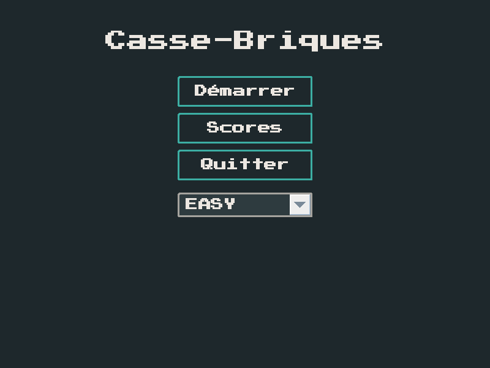
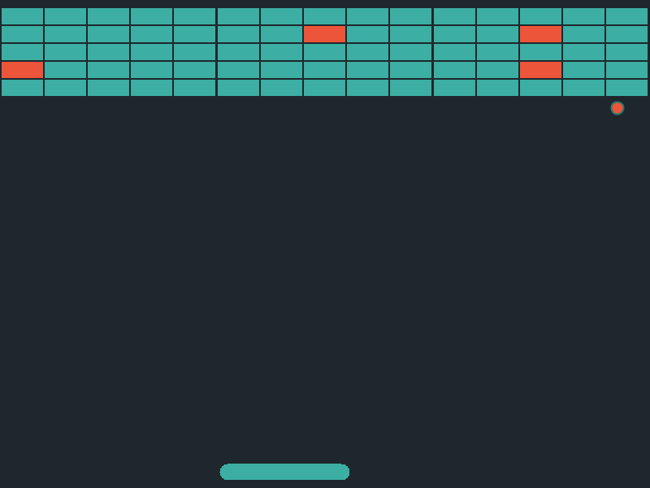

# Casse-briques

Jeu de casse-briques en **Java Swing**, réalisé pour l'examen de Programmation orientée objet
(Bachelier en informatique de gestion, EAFC, juin 2025), puis amélioré.

 

## Fonctionnalités

- 3 niveaux de difficulté (nombre de rangées, vitesse de la balle et de la raquette)
- Briques spéciales : **bombe** (détruit les briques voisines) et **multi-balles**
- Pause, écran de victoire, écran de game over
- Sauvegarde des meilleurs scores dans un fichier texte
- Thème graphique et police rétro (Press Start 2P)

## Architecture

Le code est découpé en quatre packages :

| Package  | Rôle |
|----------|------|
| `gui`    | Écrans Swing (`CardLayout` via `ScreenManager`), contrôleur, boucle de jeu |
| `metier` | Moteur (`GameEngine`), collisions et scores, exposés par des interfaces (`ICollisionService`, `IScoreService`) |
| `model`  | Entités du jeu : balle, raquette, briques (héritage `Brick` → `SimpleBrick`, `BombBrick`, `MultiBallBrick`) |
| `data`   | Persistance des scores derrière une interface (`ScoreRepository`), implémentée par `TextFileScoreRepository` |

Concepts mis en œuvre : héritage et polymorphisme, interfaces, injection de dépendances par
constructeur, pattern Observer (`GameOverListener`, `VictoryListener`), records Java,
exceptions métier dédiées par couche.

Piste d'amélioration connue : les entités de `model` se dessinent elles-mêmes et importent
donc `gui.UIConfig` (couleurs). Extraire le rendu dans `gui` découplerait complètement le modèle de Swing.

## Lancer le jeu

Prérequis : **JDK 17 ou plus récent**.

```bash
# Windows
build.bat
# Linux / macOS
./build.sh

java -jar casse-briques.jar
```

Avec IntelliJ IDEA : ouvrir le dossier, marquer `src` comme *Sources Root* puis lancer `Main`.

**Commandes :** ← → pour déplacer la raquette, Entrée pour lancer la balle, P pour mettre en pause.

## Historique

- Le tag [`examen-juin-2025`](../../tree/examen-juin-2025) correspond à la version rendue à l'examen
  (captures dans [`docs/version-examen`](docs/version-examen)).
- Ont été ajoutés ensuite : l'écran de victoire, la police rétro et une refactorisation de l'interface.
- Corrections faites lors de la mise sur GitHub (détail dans les commits `fix:`) :
  le score affiché sur l'écran de victoire, la liste des scores qui n'était pas rafraîchie,
  la lecture des scores au premier lancement, la boucle de jeu déplacée sur l'EDT Swing,
  et le multi-balles qui terminait la partie dès la perte d'une seule balle.

## Crédits

Police [Press Start 2P](https://fonts.google.com/specimen/Press+Start+2P) de CodeMan38, sous licence
SIL Open Font License 1.1 (voir [`src/fonts/OFL.txt`](src/fonts/OFL.txt)).

---
Martin Buchet
